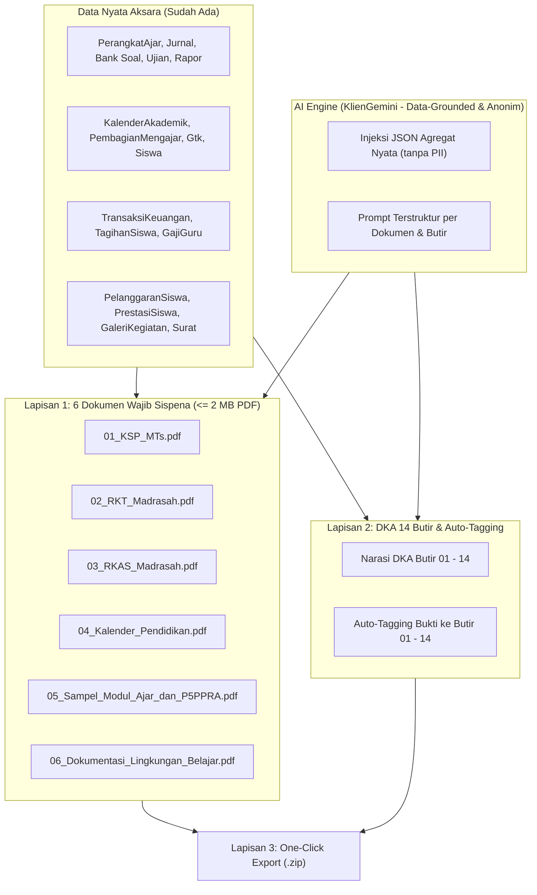

# Master Plan Gabungan: One-Click Accreditation Generator (BAN-PDM MTs)

## Evaluasi Perbandingan & Penggabungan

Rencana awal dan spesifikasi yang Anda lampirkan **sangat selaras** secara arsitektur (sama-sama berbasis 3 panduan Kurikulum Merdeka/Kemenag, *data-grounded AI* via `KlienGemini`, dan bundel visitasi). Menggabungkan keduanya menghasilkan struktur yang **jauh lebih tajam dan siap implementasi**:

| Aspek | Rencana Awal | Spesifikasi Anda (Diadopsi Penuh) | Hasil Penggabungan di Aksara |
| :--- | :--- | :--- | :--- |
| **Struktur Instrumen** | 4 Komponen umum | **14 Butir IASP BAN-PDM** (Butir 1–4, 5–9, 10–14) + KMA 450/2024–1503/2025 | Matriks tepat 14 Butir dengan pemetaan otomatis ke tabel Aksara |
| **Dokumen Wajib** | KSP, RKT, SOP, DIA | **6 Dokumen Wajib (DW) Pra-Visitasi Sispena** ($\le 2\text{ MB}$ PDF) | 6 PDF standar Sispena (KSP, RKT, RKAS, Kalender, Modul Ajar+P5, Foto Lingkungan) |
| **Pelacakan Bukti** | Hitung agregat per tabel | **Auto-Tagging Bukti** ke kode `Butir 01`–`Butir 14` | Tabel relasi polimorfik bukti $\leftrightarrow$ Butir 01–14 + agregat otomatis |
| **Output Ekspor** | Halaman cetak | **Bundel `.zip` Terstruktur** (PDF + `.xlsx` + folder per butir) | Memakai `ZipArchive`, `DomPDF`, & `OpenSpout` (`.xlsx`) yang **sudah terpasang** di Aksara |

---

## 1. Arsitektur 3 Lapisan + Data Aksara yang Sudah Tersedia

### Pemetaan Kesiapan 14 Butir di Aksara

- **Komponen 1 (Butir 1–4): Kinerja Pendidik**
  - **Butir 1** *(Sosial Emosional & Umpan Balik)*: `Rapor` (catatan wali kelas), `PelanggaranSiswa` (pembinaan), `NilaiUjian`.
  - **Butir 2** *(Pengelolaan Kelas & Disiplin Positif)*: `CatatanPiket`, `PresensiSiswa`, dokumen Kesepakatan Kelas (AI-generated).
  - **Butir 3** *(Pembelajaran Efektif & Asesmen)*: `PerangkatAjar` (ATP, Prota, Prosem, Modul Ajar), `Soal`, `Ujian`, `JurnalMengajar`.
  - **Butir 4** *(Keimanan, Akhlak, Kebangsaan & Bernalar Kritis)*: `Ekstrakurikuler`, `GaleriKegiatan`, `Modul & Rapor P5-PPRA`.
- **Komponen 2 (Butir 5–9): Kepemimpinan Kepala Madrasah**
  - **Butir 5** *(Refleksi & Evaluasi Kinerja Guru)*: Modul **Supervisi Akademik** (baru) + notulen MGMP internal.
  - **Butir 6** *(Layanan Partisipatif & Kemitraan)*: `SuratMasuk`, `SuratKeluar` (undangan komite/MoU), notulen rapat.
  - **Butir 7** *(Pengelolaan Anggaran Transparan)*: `TransaksiKeuangan`, `TagihanSiswa`, `GajiGuru`, laporan RKAS/BKU.
  - **Butir 8** *(Pengelolaan Sarana Prasarana)*: Inventaris / KIR & Foto Lingkungan Belajar (`GaleriKegiatan` / unggahan khusus sarpras).
  - **Butir 9** *(Pengembangan KSP)*: Dokumen `KSP MTs` lengkap + SK Tim Pengembang Kurikulum + Berita Acara.
- **Komponen 3 (Butir 10–14): Iklim Lingkungan Belajar**
  - **Butir 10** *(Kebinekaan & Kesetaraan)*: Demografi `Siswa` & `Gtk`, kegiatan moderasi beragama.
  - **Butir 11** *(Lingkungan Inklusif)*: SOP layanan inklusif & pemetaan kebutuhan belajar (AI-generated).
  - **Butir 12** *(Keamanan Psikis & Anti-Kekerasan)*: SK TPPK, SOP Anti-Perundungan (AI-generated), log `PelanggaranSiswa`.
  - **Butir 13** *(Keselamatan Fisik & Mitigasi Bencana)*: Ceklis inspeksi bangunan, P3K, SOP evakuasi (AI-generated).
  - **Butir 14** *(Lingkungan Sehat, UKS & Kesehatan Mental)*: Program UKS, pengawasan kantin sehat (AI-generated + foto).

---

## 2. Kelayakan Teknis Paket Output `.zip` pada Codebase Saat Ini

Berdasarkan pemeriksaan `composer.json` dan ekstensi PHP di environment Aksara:
- **`.zip` (`ZipArchive`):** **Sudah tersedia** (`ZIP_OK`), siap membungkus seluruh folder `01_Dokumen_Wajib_Sispena/` hingga `05_Lembar_Ceklis_Kesiapan_Lapangan.pdf`.
- **`.pdf` (`barryvdh/laravel-dompdf`):** **Sudah terpasang**, siap membuat ke-6 PDF Dokumen Wajib dengan validasi ukuran $\le 2\text{ MB}$ (optimasi resolusi gambar kolase sebelum render PDF).
- **`.xlsx` (`openspout/openspout`):** **Sudah terpasang** (dipakai di `LegerExport`), siap membuat `02_Mapping_Bukti_14_Butir.xlsx` secara native!

> [!NOTE]
> **Catatan Mengenai `.docx` dan `.pptx`:**
> Saat ini di `composer.json` belum terpasang `phpoffice/phpword` maupun `phpoffice/phppresentation`.
> - Untuk **`.docx` (`02_Draft_Isian_DKA_14_Butir.docx`)**: Kita bisa menginstal `phpoffice/phpword` (atau menghasilkan dokumen HTML/PDF siap salin-tempel ke Sispena).
> - Untuk **`.pptx` (`04_Deck_Presentasi_Kepala_Madrasah.pptx`)**: Dapat di-generate dalam bentuk **Deck Presentasi PDF Landscape (16:9)** via DomPDF (langsung bisa dipresentasikan layar penuh saat visitasi!), atau menginstal `phpoffice/phppresentation` jika wajib `.pptx` yang bisa diedit.

---

## 3. Rencana Perubahan Teknis (Bertahap)

### Fase 1: Fondasi 14 Butir, 6 Dokumen Wajib, DKA AI & Ekspor Bundel `.zip`
1. **Database & Model:**
   - `akreditasi_dokumens` (menyimpan 6 DW, 14 narasi DKA, dan dokumen pendukung per `tahun_ajaran_id`, `kode_butir`, `jenis`, `isi_html`, `status`, `dibantu_ai`).
   - `akreditasi_buktis` (tabel polimorfik `taggable` atau manual upload untuk menandai/mengelompokkan foto sarpras, SK, surat, dan dokumen ke `Butir 01`–`Butir 14`).
2. **Service Layer:**
   - `App\Services\Akreditasi\PetaButirBanPdm` — Definisi master 14 Butir BAN-PDM MTs & metrik kelengkapan otomatis dari database Aksara.
   - `App\Services\Akreditasi\PenyusunAkreditasiAi` — Generator *Data-Grounded* menggunakan `KlienGemini` + prompt khusus di `resources/prompts/akreditasi/` (menyusun KSP, RKT, RKAS, narasi DKA 14 Butir, dan SOP Butir 10–14 dari ringkasan angka nyata Aksara tanpa PII).
   - `App\Services\Akreditasi\PembuatBundelAkreditasi` — Menyusun file PDF ($\le 2\text{ MB}$), `02_Mapping_Bukti_14_Butir.xlsx`, folder `Butir_01..14/`, dan membungkusnya menjadi 1 file `.zip` siap unduh.
3. **UI Panel Admin (`/admin` → Grup `Kurikulum` / `Akreditasi`):**
   - Halaman **Pusat Akreditasi BAN-PDM**: Checklist 14 Butir + Skor Kesiapan + tombol **Generate dengan AI** per dokumen/butir + tombol **One-Click Ekspor Bundel Visitasi (.zip)**.

### Fase 2: Modul & Rapor Projek P5-PPRA
- Manajemen Tema, Dimensi P5, Nilai Rahmatan Lil Alamin (P2RA), Generator Modul Projek P5-PPRA dengan AI, input capaian siswa, dan cetak **Rapor P5-PPRA** (otomatis terhubung ke **Butir 4** & **DW 5**).

### Fase 3: Supervisi Akademik Kepala Madrasah & Sarpras (KIR)
- Form jadwal & instrumen supervisi guru oleh Kepala Madrasah (otomatis terhubung ke **Butir 5**) serta daftar inventaris/foto ruangan (otomatis terhubung ke **Butir 8** & **DW 6**).

---

## Pertanyaan Konfirmasi Sebelum Mulai Fase 1

> [!IMPORTANT]
> Mohon konfirmasi 2 poin berikut agar saya bisa langsung mengeksekusi **Fase 1**:

1. **Format DKA & Deck Presentasi di Bundel `.zip`:**
   Apakah Anda ingin saya **menginstal `phpoffice/phpword`** agar `02_Draft_Isian_DKA_14_Butir.docx` keluar sebagai file Word (`.docx`) asli, dan menggunakan **PDF Slide Landscape 16:9** untuk `04_Deck_Presentasi_Kepala_Madrasah.pdf` (atau perlu install `phppresentation` juga)?
2. **Eksekusi Fase 1:**
   Apakah Anda menyetujui rencana **Fase 1** di atas (14 Butir + Auto-Tagging + 6 Dokumen Wajib + DKA 14 Butir AI + Ekspor `.zip` dengan `.xlsx` & `.pdf`) untuk langsung saya kerjakan?
