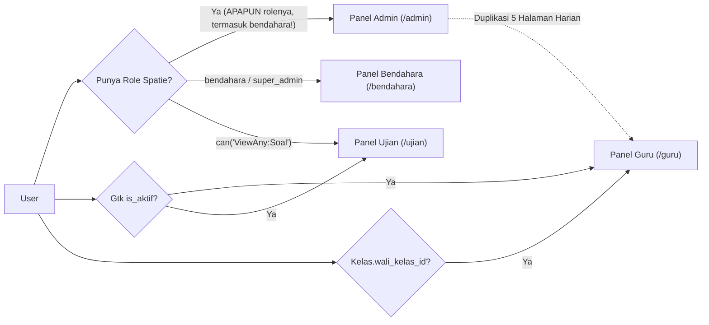
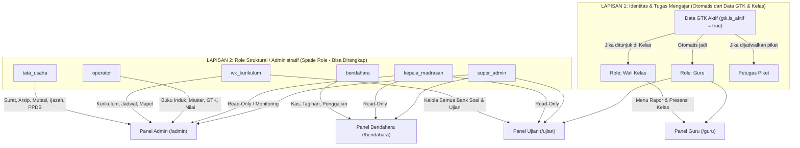

# Analisis & Rencana Penyederhanaan Hak Akses Panel dan Resource

## Ringkasan Tujuan

Dokumen ini menganalisis sistem hak akses saat ini pada aplikasi **Aksara** (4 Panel Filament: `admin`, `guru`, `bendahara`, `ujian`) terhadap **8 Role** yang dibutuhkan (`Super Admin`, `Kepala Madrasah`, `WK Kurikulum`, `Bendahara`, `Wali Kelas`, `Guru`, `Operator`, `Tata Usaha`) — dengan kondisi bahwa **ke-8 role tersebut dapat merangkap sebagai Guru**.

---

## 1. Kondisi Saat Ini & Temuan Ambiguitas

Saat ini aplikasi memiliki **4 Panel** dan **4 Role** di `RoleSeeder.php` (`super_admin`, `operator`, `wk_kurikulum`, `bendahara`). Role `kepala_madrasah` dan `tata_usaha` **belum ada**, sedangkan `guru` dan `wali_kelas` tidak memakai Role Spatie melainkan membaca relasi `User -> Gtk` dan `Kelas.wali_kelas_id`.

### Diagram Kondisi Saat Ini (Bermasalah / Ambigu)

### 6 Titik Ambigu & Bug yang Ditemukan di Kode

> [!CAUTION]
> **1. Pintu Masuk Panel Admin Terlalu Longgar (`User::canAccessPanel`)**
> Di [User.php](../app/Models/User.php#L65-L73), akses ke panel `admin` menggunakan `default => $this->roles()->exists()`.
> **Dampak:** User dengan role `bendahara` (yang seharusnya hanya di `/bendahara` dan punya 0 permission di admin) **bisa masuk ke `/admin`**. Jika dia juga merangkap Guru (`gtk.is_aktif = true`), maka di `/admin` dia juga melihat menu `Administrasi Harian` karena 5 halaman guru didaftarkan ulang di `AdminPanelProvider`.

> [!WARNING]
> **2. Reset Password GTK Terkunci oleh Cek `roles()->exists()` (`AkunGtk::bolehDireset`)**
> Di [AkunGtk.php](../app/Services/Kepegawaian/AkunGtk.php#L63-L70), Operator hanya boleh mereset password GTK jika `! $gtk->user->roles()->exists()`.
> **Dampak:** Jika nantinya `guru`, `wali_kelas`, atau `panel_user` diberi Role Spatie, Operator **tidak bisa lagi** mereset password guru tersebut.

> [!WARNING]
> **3. Controller Cetak Perangkat Ajar Menganggap Semua Role = Admin**
> Di [CetakAtpController.php](../app/Http/Controllers/CetakAtpController.php#L21-L22), [CetakProtaController.php](../app/Http/Controllers/CetakProtaController.php#L22-L23), [CetakProsemController.php](../app/Http/Controllers/CetakProsemController.php#L22-L23), dan [CetakPerangkatAjarController.php](../app/Http/Controllers/CetakPerangkatAjarController.php#L24-L26):
> `$isAdmin = $user->hasRole('super_admin') || $user->roles()->exists();`
> **Dampak:** Role apa pun (misalnya `bendahara` atau `tata_usaha`) otomatis dianggap admin dan boleh mencetak perangkat ajar milik guru lain.

> [!NOTE]
> **4. Duplikasi 5 Halaman Harian di `AdminPanelProvider` & `GuruPanelProvider`**
> `PresensiKelas`, `JurnalMengajar`, `KehadiranGtk`, `BukuPiket`, dan `RekapHarian` didaftarkan di [AdminPanelProvider.php](../app/Providers/Filament/AdminPanelProvider.php#L105-L110) sekaligus otomatis di-discover di [GuruPanelProvider.php](../app/Providers/Filament/GuruPanelProvider.php#L73). Ini membuat pengguna bingung harus mengisi/melihat presensi dan piket di `/admin` atau `/guru`.

> [!NOTE]
> **5. Mekanisme Otorisasi Tidak Seragam**
> - Panel `admin`: Memakai **Shield Permission** (`ViewAny:Siswa`, `View:BackupData`).
> - Panel `bendahara`: Hardcode **nama role** (`hasAnyRole(['bendahara', 'super_admin'])`).
> - Panel `guru`: Berbasis **relasi GTK & Kelas** (`gtk.is_aktif`, `wali_kelas_id`).
> - Panel `ujian`: Campuran **GTK aktif** atau **Shield Permission** (`ViewAny:Soal`).

> [!NOTE]
> **6. Role `Kepala Madrasah` dan `Tata Usaha` Belum Ada**
> Di [RoleSeeder.php](../database/seeders/RoleSeeder.php), belum ada definisi izin untuk `kepala_madrasah` dan `tata_usaha`.

---

## 2. Desain Penyederhanaan: Model "2 Lapisan" (Identitas GTK + Role Struktural)

Agar mudah dipahami dan dikelola oleh madrasah, **8 Role tidak perlu semuanya dijadikan Role Spatie**. Pisahkan menjadi **2 lapisan yang ortogonal (saling melengkapi dan bisa ditumpuk)**:

### Sketsa Arsitektur yang Disarankan

**Mengapa desain ini jauh lebih sederhana?**
1. **Admin/Operator tidak perlu repot memberi/mencabut role "Guru" atau "Wali Kelas"** setiap semester. Begitu GTK dibuat dan diaktifkan, akunnya otomatis punya Panel Guru & Ujian. Begitu GTK ditunjuk sebagai Wali Kelas di data Kelas, menu `Rapor Kelas Saya` otomatis muncul.
2. **Rangkap Jabatan (Multi-Role) 100% alami:** Seorang Guru yang diangkat menjadi `WK Kurikulum` atau `Bendahara` tetap memiliki akses Panel Guru sebagai guru, dan tinggal ditambahkan 1 Role Struktural (`wk_kurikulum` atau `bendahara`) di menu Pengguna.
3. **Setiap Panel punya tujuan tunggal yang jelas:**
   - **Panel Guru (`/guru`)**: Ruang kerja mengajar pribadi (Jadwal Saya, Input Nilai mapel sendiri, Perangkat Ajar sendiri, Presensi/Jurnal/Piket, Rapor Kelas Perwalian).
   - **Panel Ujian (`/ujian`)**: Ruang kerja Bank Soal & Naskah Ujian (Guru untuk mapelnya sendiri; WK Kurikulum/Super Admin untuk seluruh mapel).
   - **Panel Bendahara (`/bendahara`)**: Ruang kerja Keuangan (Kas, Tagihan Siswa, Penggajian).
   - **Panel Admin (`/admin`)**: Ruang kerja Tata Kelola Sekolah & Data Induk (Operator, WK Kurikulum, Tata Usaha, Kepala Madrasah, Super Admin).

---

## 3. Matriks Hak Akses Panel & Resource yang Diusulkan

### A. Akses Panel (`canAccessPanel`)

| Role / Status | `/admin` (Admin) | `/guru` (Guru) | `/ujian` (Ujian) | `/bendahara` (Bendahara) |
| :--- | :---: | :---: | :---: | :---: |
| **1. Super Admin** | ✅ Penuh | ✅ *(jika GTK aktif)* | ✅ Penuh | ✅ Penuh |
| **2. Kepala Madrasah** | ✅ *(Read-Only)* | ✅ *(jika GTK aktif)* | ✅ *(Read-Only)* | ✅ *(Read-Only)* |
| **3. WK Kurikulum** | ✅ *(Kurikulum)* | ✅ *(jika GTK aktif)* | ✅ Penuh | ❌ |
| **4. Bendahara** | ❌ *(Kecuali punya role admin lain)* | ✅ *(jika GTK aktif)* | ✅ *(jika GTK aktif)* | ✅ Penuh |
| **5. Wali Kelas** *(via Kelas)* | ❌ | ✅ *(+ Rapor & Presensi Kelas)* | ✅ *(Mapel sendiri)* | ❌ |
| **6. Guru** *(via GTK Aktif)* | ❌ | ✅ *(Kerja Guru)* | ✅ *(Mapel sendiri)* | ❌ |
| **7. Operator** | ✅ *(Data Induk & Master)* | ✅ *(jika GTK aktif)* | ✅ *(jika GTK aktif)* | ❌ |
| **8. Tata Usaha** | ✅ *(Persuratan & Arsip)* | ✅ *(jika GTK aktif)* | ✅ *(jika GTK aktif)* | ❌ |

### B. Pemetaan Menu / Resource di Panel Admin (`/admin`)

| Grup / Resource | Super Admin | Kepala Madrasah | Operator | WK Kurikulum | Tata Usaha |
| :--- | :---: | :---: | :---: | :---: | :---: |
| **Buku Induk** (Siswa, Rapor, Leger, Kenaikan, InputNilaiKelas) | Full | View | Full *(tanpa ForceDelete)* | View *(Leger/Rapor)* | View *(Siswa/Rapor)* |
| **Buku Induk — Mutasi & Ijazah** | Full | View | View | ❌ | Full |
| **Buku Induk — PPDB & Galeri** | Full | View | Full | ❌ | Full |
| **Kepegawaian** (GTK, Penugasan Piket) | Full | View | Full | View *(GTK)* | View *(GTK)* |
| **Kurikulum** (Jadwal, Jam, Kalender, Pembagian Mengajar, Permintaan Jadwal, Mapel) | Full | View | View | Full | ❌ |
| **Tata Usaha** (Surat Masuk, Surat Keluar, Kop Surat, Penanda Tangan) | Full | View | ❌ | ❌ | Full |
| **Master Data** (Tahun Ajaran, Kelas, Ekstrakurikuler) | Full | View | Full | View *(Kelas)* | ❌ |
| **Pengaturan** (User, Role, Backup, Activity Log, AI API Key) | Full | View *(Activity)* | ❌ | ❌ | ❌ |

---

## 4. Pertanyaan Klarifikasi Sebelum Implementasi

> [!IMPORTANT]
> Mohon konfirmasi 4 keputusan berikut agar perubahan kode nantinya tepat sesuai alur kerja di madrasah Anda:

1. **Peran Kepala Madrasah:**
   Apakah `kepala_madrasah` sifatnya **murni Read-Only (melihat & mencetak laporan/rekap)** di Panel Admin, Bendahara, dan Ujian, atau ada menu tertentu yang boleh diubah/disetujui oleh Kepala Madrasah?
2. **Batas Tugas Operator vs Tata Usaha:**
   Untuk **PPDB, Mutasi Siswa, dan Ijazah**, apakah dikelola oleh **Tata Usaha**, **Operator**, atau **keduanya**?
3. **Lokasi Menu Administrasi Harian (`PresensiKelas`, `JurnalMengajar`, `KehadiranGtk`, `BukuPiket`, `RekapHarian`):**
   Saat ini ke-5 halaman tersebut muncul di **Panel Guru** DAN **Panel Admin**. Apakah sebaiknya ke-5 halaman tersebut **hanya ada di Panel Guru** (agar Operator/TU/Admin yang bukan guru tidak melihat menu absen mengajar di Admin, dan di Admin cukup ada `Penugasan Piket` + `Rekap Harian`)?
4. **Status Role Guru & Wali Kelas:**
   Apakah Anda setuju `Guru` dan `Wali Kelas` **tetap otomatis** dari data `GTK Aktif` dan `Kelas` (bukan Role Spatie manual), sehingga Admin tidak perlu mengatur role saat guru baru masuk atau saat pergantian wali kelas?

---

## 5. Rencana Perubahan Teknis (Jika Disetujui)

Berikut file-file yang akan dirapikan setelah konfirmasi Anda:

### Otorisasi Panel & User
#### [MODIFY] [User.php](../app/Models/User.php)
- Ubah `canAccessPanel()` agar `admin` panel tidak lagi memakai `default => $this->roles()->exists()`, melainkan hanya mengizinkan role pengelola admin (atau cek permission khusus seperti `Access:AdminPanel` / daftar role admin).
- Perbarui `bolehKelolaKeuangan()` agar `kepala_madrasah` bisa mengakses Panel Bendahara dalam mode read-only (jika disetujui).

### Seeder Role & Permission
#### [MODIFY] [RoleSeeder.php](../database/seeders/RoleSeeder.php)
- Tambahkan role `kepala_madrasah` (izin `ViewAny:*` dan `View:*`) dan `tata_usaha` (izin persuratan, arsip, mutasi, ijazah, PPDB sesuai kesepakatan).
- Pastikan izin `bendahara` jelas dan terpisah dari Panel Admin.

### Panel Providers & Halaman Harian
#### [MODIFY] [AdminPanelProvider.php](../app/Providers/Filament/AdminPanelProvider.php)
- Hapus duplikasi halaman `Guru\Pages\*` dari Panel Admin (atau sisakan `RekapHarian` saja sesuai keputusan poin 3).

### Perbaikan Bug Kontrol Akses
#### [MODIFY] [AkunGtk.php](../app/Services/Kepegawaian/AkunGtk.php)
- Perbarui `bolehDireset()` agar mengecek apakah user punya role *pengelola sistem* (`super_admin`, `operator`, dll.), bukan sekadar `roles()->exists()`.

#### [MODIFY] [CetakAtpController.php](../app/Http/Controllers/CetakAtpController.php), [CetakProtaController.php](../app/Http/Controllers/CetakProtaController.php), [CetakProsemController.php](../app/Http/Controllers/CetakProsemController.php), [CetakPerangkatAjarController.php](../app/Http/Controllers/CetakPerangkatAjarController.php)
- Ganti pengecekan `$user->roles()->exists()` dengan pengecekan role/permission yang spesifik (misal `super_admin`, `kepala_madrasah`, `wk_kurikulum`) agar role seperti `bendahara` tidak otomatis bisa mengakses perangkat ajar guru lain.

---

## 6. Rencana Verifikasi

### Automated Tests
- Menjalankan test suite yang ada dengan `php artisan test` serta menambahkan feature test untuk memastikan setiap dari 8 skenario role (termasuk yang merangkap sebagai Guru) hanya dapat mengakses panel dan resource yang seharusnya.

### Manual Verification
- Uji login sebagai masing-masing role (Guru murni, Wali Kelas, Bendahara + Guru, WK Kurikulum + Guru, Tata Usaha, Operator, Kepala Madrasah, Super Admin) dan verifikasi menu sidebar serta akses URL panel secara langsung.
