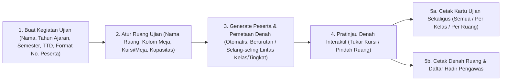

# Rencana Implementasi: Kartu Ujian Sekaligus & Pemetaan Denah

## Deskripsi Tujuan

Menambahkan fitur **Kartu Ujian Massal** dan **Pemetaan Denah Ruang Ujian** di **Panel Ujian (`/ujian`)**. Berbeda dengan resource `Ujian` yang bersifat per-mata pelajaran, Kartu Ujian dan Denah Ruang bersifat **per kegiatan/periode ujian** (misalnya *Penilaian Akhir Semester Ganjil 2026/2027*) yang mencakup seluruh siswa atau tingkat tertentu.

---

## Arsitektur & Alur Fitur

---

## Pertanyaan Klarifikasi Sebelum Eksekusi

> [!IMPORTANT]
> Mohon konfirmasi 4 poin berikut agar implementasi sesuai dengan kebutuhan di madrasah Anda:

1. **Hak Akses Pengelola:**
   Siapa saja yang boleh membuat & mencetak **Kartu Ujian + Denah** di Panel Ujian?
   - **Opsi A (Rekomendasi):** `WK Kurikulum` & `Super Admin` (kelola penuh), `Kepala Madrasah` (*read-only* / cetak), sementara `Guru` biasa hanya melihat `Bank Soal` & `Ujian` miliknya.
   - **Opsi B:** `Operator` & `Tata Usaha` juga diberi akses penuh untuk mengelola Kartu Ujian & Denah.
2. **Pola Meja & Denah Ruang:**
   - Apakah 1 meja berisi **1 kursi** (1 siswa/meja) atau **2 kursi bersebelahan** (kiri-kanan, misal siswa Kelas VII duduk sebangku dengan Kelas VIII/IX agar tidak menyontek), atau dibuat **pilihan fleksibel per ruang**?
   - Format **Nomor Peserta** default yang diinginkan seperti apa? (Misalnya `26-07-001` = tahun-tingkat-urut, atau `01-001` = kode ruang-urut, dengan opsi prefix kustom).
3. **Isi Kartu Ujian:**
   - Cukup **Identitas Siswa + Foto + Nomor Peserta + Ruang/Kursi + Tanda Tangan Panitia/Kepala**, atau perlu opsi tambahan **Tabel Jadwal Ujian** di kartu?
4. **Format Cetak:**
   - Menggunakan **Browser Print** (seperti cetak Naskah Soal di [CetakUjianController.php](../app/Http/Controllers/CetakUjianController.php), sangat cepat untuk mencetak 100–500 kartu sekaligus beserta foto siswa tanpa batas memori DomPDF), dengan pilihan ukuran kertas **F4 / A4** (4 atau 6 kartu per halaman). Apakah ini sudah sesuai?

---

## Rencana Perubahan Teknis

### 1. Skema Database & Model
#### [NEW] Migration `create_kegiatan_ujians_dan_denah_tables`
- **`kegiatan_ujians`**: `id`, `nama` (misal *PAS Ganjil 2026/2027*), `tahun_ajaran_id`, `semester`, `tanggal_mulai`, `tanggal_selesai`, `prefix_nomor_peserta` (opsional), `penanda_tangan_id` (nullable, untuk TTD kartu & denah), `kop_surat_id` (nullable), `catatan_kartu` (tata tertib singkat di kartu), `user_id`.
- **`ruang_ujians`**: `id`, `kegiatan_ujian_id`, `kode` (misal `R-01`), `nama` (misal `Ruang 01 - Lab IPA`), `urutan`, `jumlah_kolom` (default `4`), `kursi_per_meja` (`1` atau `2`, default `1`), `kapasitas` (misal `20` atau `32`).
- **`penempatan_ujians`** (peserta per kegiatan ujian): `id`, `kegiatan_ujian_id`, `ruang_ujian_id` (nullable jika belum dipetakan), `siswa_id`, `kelas_id`, `nomor_peserta`, `nomor_kursi` (1..N), `urutan_posisi` (posisi slot di grid denah). Unique index `(kegiatan_ujian_id, siswa_id)` dan `(kegiatan_ujian_id, nomor_peserta)`.

#### [NEW] Models: `KegiatanUjian`, `RuangUjian`, `PenempatanUjian`

---

### 2. Service Pemetaan Denah & Nomor Peserta
#### [NEW] `app/Services/Cbt/PemetaanDenahUjian.php`
- **`ambilSiswaSasaran(KegiatanUjian $kegiatan, array $tingkat, array $kelasIds)`**: Mengambil siswa aktif sesuai filter.
- **`petakan(KegiatanUjian $kegiatan, string $mode, array $opsi)`**:
  - Mode `berurutan`: Mengisi ruang secara berurutan per kelas/tingkat.
  - Mode `selang_seling`: Mengacak/menyelang-selingkan siswa antar kelas atau antar tingkat (misal posisi ganjil/kiri dari Tingkat VII, posisi genap/kanan dari Tingkat VIII/IX) ke dalam tiap meja/ruang.
  - Otomatis menghasilkan `nomor_peserta` dan `nomor_kursi` secara deterministik dan transaksional (`DB::transaction`).
- **`tukarKursi(PenempatanUjian $a, PenempatanUjian $b)`**: Memindahkan atau menukar posisi duduk dua siswa di grid denah.

---

### 3. Antarmuka Panel Ujian (`/ujian`)
#### [MODIFY] [UjianPanelProvider.php](../app/Providers/Filament/UjianPanelProvider.php) & [User.php](../app/Models/User.php)
- Aktifkan `discoverPages` di `UjianPanelProvider` jika diperlukan, dan pastikan izin Shield untuk `KegiatanUjian` ditambahkan di [RoleSeeder.php](../database/seeders/RoleSeeder.php).

#### [NEW] `app/Filament/Ujian/Resources/KegiatanUjians/KegiatanUjianResource.php`
- Menu baru di Panel Ujian: **Kartu & Denah Ujian** (`navigationSort = 3`).
- Halaman utama (`List`, `Create`, `Edit`) + 2 halaman khusus per record:
  1. **`KelolaRuangDanDenah`** (`/{record}/denah`):
     - Tab/Panel pengaturan Ruang Ujian (tambah/edit ruang, kolom, kursi per meja, kapasitas).
     - Tombol **Generate Peserta & Petakan Denah** (pilih tingkat/kelas, mode berurutan/selang-seling, format nomor peserta).
     - **Visualisasi Grid Denah** per ruang (menampilkan kotak meja, nomor kursi, nama siswa, kelas, nomor peserta) dengan aksi cepat **Tukar Posisi** atau **Pindah Ruang**.
     - Tombol **Cetak Denah Ruang** & **Cetak Kartu Ujian** (bisa filter per ruang, per kelas, atau semua).
  2. **`DaftarPesertaUjian`** (atau terintegrasi di halaman Denah dalam tab *Daftar Nomor Peserta*):
     - Tabel searchable seluruh peserta untuk edit manual nomor peserta atau cetak kartu per siswa/kelas.

---

### 4. Halaman Cetak Kartu Ujian & Denah
#### [NEW] `app/Http/Controllers/CetakDenahDanKartuController.php`
- Route:
  - `GET /cetak-kartu-ujian/{kegiatan}` (query param opsional: `?ruang_id=`, `?kelas_id=`, `?kolom=2` / `4` atau `6` kartu per halaman, `?kertas=f4|a4`)
  - `GET /cetak-denah-ujian/{kegiatan}` (query param opsional: `?ruang_id=`)
- View Blade print-ready:
  - `resources/views/cetak/kartu-ujian.blade.php` — Grid kartu ujian presisi dengan `break-inside: avoid`, Kop Madrasah, pas foto (atau placeholder 3x4), identitas peserta, nomor peserta, ruang & nomor kursi, serta tanda tangan.
  - `resources/views/cetak/denah-ujian.blade.php` — Layout visual meja/kursi per ruang (1 halaman per ruang) lengkap dengan posisi Pengawas di depan kelas, daftar rekap jumlah peserta per kelas di ruang tersebut, dan tanda tangan panitia.

---

## Rencana Verifikasi

### Automated Tests
- `tests/Feature/Cbt/KartuDanDenahUjianTest.php`:
  - Uji pembuatan `KegiatanUjian` & `RuangUjian`.
  - Uji algoritma pemetaan `berurutan` dan `selang_seling` (memastikan kapasitas ruang dihormati, tidak ada kursi ganda, dan semua siswa mendapat nomor peserta unik).
  - Uji aksi tukar kursi dua peserta.
  - Uji akses otorisasi (guru biasa tidak bisa mengakses/mengubah, `wk_kurikulum` & `super_admin` bisa, `kepala_madrasah` read-only).
  - Uji route cetak kartu ujian dan cetak denah mengembalikan HTTP 200 dengan data siswa & ruang yang benar.

### Manual Verification
- Uji tampilan grid denah di browser dan *Print Preview* (Ctrl+P) pada ukuran kertas F4/A4 untuk memastikan kartu ujian tidak terpotong antar halaman.
